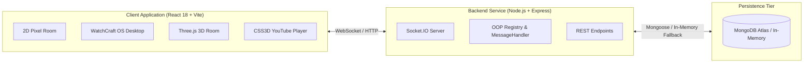

# 🎬 WatchCraft — 3D & 2D YouTube Watch Party System

> **Watch together. React together in 3D.** An immersive web application combining a retro 2D pixel apartment workstation with a synchronized, first-person 3D theater room where YouTube videos are projected directly onto a virtual television in real time.

---

## 📑 Table of Contents

- [Overview](#-overview)
- [Key Features](#-key-features)
- [Architecture & Tech Stack](#-architecture--tech-stack)
- [Assignment Requirements Mapping](#-assignment-requirements-mapping)
- [Role-Based Access Control](#-role-based-access-control-rbac)
- [Local Development Setup](#-local-development-setup)
- [Environment Variables](#-environment-variables)
- [Deployment Guide](#-deployment-guide)
- [Project Directory Structure](#-project-directory-structure)
- [Troubleshooting](#-troubleshooting)

---

## 🌟 Overview

**WatchCraft** bridges retro pixel gaming aesthetics with state-of-the-art 3D web graphics to solve the isolation of remote media consumption. Instead of staring at a standard video grid, users:
1. Explore an isometric **2D pixel apartment** using WASD or mouse navigation.
2. Interact with objects, read official project policies and terms, and sit at their retro desktop workstation.
3. Boot up **WatchCraft OS** to create, search, or join watch party rooms.
4. Step directly into an immersive **3D virtual living room** built with Three.js, where a synchronized YouTube video plays on the room's television via CSS3D projection while users chat, send floating emoji reactions, and look around using first-person mouse controls.

---

## ✨ Key Features

### 🕹️ Dual-World Interactive Experience
- **Retro 2D Apartment (`GameRoomScreen.jsx`)**: Isometric canvas with smooth WASD movement, interactive furniture, dialogue boxes, sound effects, and an interactive legal document viewer.
- **WatchCraft OS (`WatchlyDesktop.jsx`)**: Terminal-style boot sequence, display name authentication, room creator modal, genre filter, and public room explorer.
- **Immersive 3D Room (`WatchRoom3D.jsx`)**: Photorealistic baked 3D room geometry rendered via Three.js with first-person pointer-lock mouse look, interactive wall art gallery, day/night lighting toggles, and aligned CSS3D television projection.

### 📺 Synchronized YouTube Playback
- **Authoritative Server State**: Backend maintains canonical playback state (`videoId`, `playState`, `currentTime`).
- **Low-Latency Synchronization**: Real-time play, pause, seek, and video-change events broadcasted via Socket.IO.
- **Drift Compensation & Loop Prevention**: Automatic timestamp delta correction ($\Delta t \ge 2\text{s}$) with remote echo suppression to prevent infinite feedback loops.
- **Late Joiner Sync**: New participants instantly inherit current video time and play status upon joining.
- **Local Control Preferences**: Volume, mute toggles, mouse sensitivity, and fullscreen mode remain strictly local to each user.

### 👥 Role-Based Access Control (RBAC)
- **Host (👑)**: Automatically assigned to the room creator. Full control over playback, video selection, participant management (promote to Moderator, kick user), and room ownership transfer.
- **Moderator (⚔️)**: Authorized to play, pause, seek, and change videos.
- **Participant (👁️)**: Enjoys synchronized playback. Can use the built-in **Request Control** feature to ask the Host for promotion.
- **Server-Side Enforcement**: All mutations are validated in backend OOP classes (`MessageHandler.js` and `Participant.js`); client UI restrictions are purely cosmetic.

### 💬 Social & Multiplayer
- **Live Text Chat**: Real-time messaging with timestamping, role badges, and input sanitization.
- **Floating Emoji Reactions**: Interactive reaction tray (❤️, 😂, 😮, 🔥, 👏, 💯) with animated floating particle physics.
- **Auto Host Migration**: Automatic host re-assignment if the active host leaves the room.
- **Genre Directory**: Organize and discover public rooms across Anime, Movies, Music, Gaming, TV Shows, and Education.

---

## 🏛️ Architecture & Tech Stack



### Technology Breakdown

| Component | Technology | Role |
| :--- | :--- | :--- |
| **Frontend Framework** | React 18 + Vite | Reactive UI components, high-performance bundling |
| **3D Rendering** | Three.js (`r186`) + CSS3DRenderer | 3D room rendering, camera controls, TV screen mapping |
| **Styling** | Vanilla CSS + Tailwind utilities | Custom retro window styling, CRT scanlines, responsive layouts |
| **Real-time Protocol** | Socket.IO Client / Server (`v4.7+`) | Bi-directional event transport with reconnection fallback |
| **Video Engine** | YouTube IFrame Player API | Video decoding, seek control, state event listeners |
| **Backend Runtime** | Node.js + Express | HTTP REST APIs, health checks, WebSocket server hosting |
| **Backend Architecture**| Pure OOP Classes (`Room`, `Participant`, etc.) | Domain-driven business logic and clean encapsulation |
| **Database** | MongoDB Atlas + Mongoose | Room metadata and analytics persistence (with offline fallback) |

*For deep architectural details, see the dedicated [Architecture Documentation](file:///docs/ARCHITECTURE.md).*

---

## 📋 Assignment Requirements Mapping

Below is the verification checklist mapping requirements from the **Intern Assignment: YouTube Watch Party System** specification directly to the WatchCraft codebase:

| Requirement Area | Specification Item | Implementation Source | Status |
| :--- | :--- | :--- | :---: |
| **A. Room Management** | Create room with unique identifier | `watchly-backend/src/classes/RoomRegistry.js` (`create()`) | ✅ Verified |
| | Creator assigned Host role | `watchly-backend/src/classes/Room.js` (`addParticipant()`) | ✅ Verified |
| | Join via room code / link | `src/WatchlyDesktop.jsx`, `MessageHandler.js` (`_onJoinRoom`) | ✅ Verified |
| | Default Participant role for joiners | `watchly-backend/src/classes/Room.js` (`role: 'participant'`) | ✅ Verified |
| | Invalid room code error handling | `MessageHandler.js`, `WatchlyDesktop.jsx` | ✅ Verified |
| | Room state & participant persistence | `Room.js`, `Room.model.js`, `mongodb.js` | ✅ Verified |
| **B. Playback Sync** | YouTube IFrame API integration | `src/WatchRoom3D.jsx` (`onYouTubeIframeAPIReady`) | ✅ Verified |
| | Synchronized play, pause, seek, change | `WatchRoom3D.jsx`, `MessageHandler.js` (`_onPlay`, etc.) | ✅ Verified |
| | Server-authoritative playback state | `Room.js` (`updateVideoState()`), `MessageHandler.js` | ✅ Verified |
| | Late-joiner synchronization | `MessageHandler.js` (`_onJoinRoom` callback & `sync_state`)| ✅ Verified |
| | Loop prevention / echo suppression | `WatchRoom3D.jsx` (`isRemoteUpdate` ref & delta check) | ✅ Verified |
| | 3D TV Alignment & camera independence | `WatchRoom3D.jsx` (`CSS3DRenderer`, local camera) | ✅ Verified |
| **C. Role-Based Access** | Host privileges (playback, kick, promote) | `Participant.js` (`isHost()`), `MessageHandler.js` | ✅ Verified |
| | Moderator privileges (playback controls) | `Participant.js` (`canControl()`), `MessageHandler.js` | ✅ Verified |
| | Participant restrictions | `MessageHandler.js` (`_requireControl()` guard) | ✅ Verified |
| | Server-side RBAC validation | `MessageHandler.js` (enforced on all mutation events) | ✅ Verified |
| | Role promotion & control request workflow| `MessageHandler.js` (`_onAssignRole`, `_onRequestControl`)| ✅ Verified |
| **D. WebSocket Events** | `join_room`, `leave_room`, `sync_state` | `MessageHandler.js`, `socket.js`, `WatchRoom3D.jsx` | ✅ Verified |
| | `play`, `pause`, `seek`, `change_video` | `MessageHandler.js`, `WatchRoom3D.jsx` | ✅ Verified |
| | `assign_role`, `remove_participant` | `MessageHandler.js`, `WatchRoom3D.jsx` | ✅ Verified |
| | `user_joined`, `user_left`, `role_assigned` | `MessageHandler.js`, `WatchRoom3D.jsx` | ✅ Verified |
| **E. Extras & Bonuses** | OOP backend encapsulation (`Room`, `Participant`, etc.) | `watchly-backend/src/classes/` | ✅ Verified |
| | Scalability & high-concurrency architecture | `docs/ARCHITECTURE.md` (Sec. 9: Redis, LB, Clustering) | ✅ Documented |
| | Live room text chat & reactions | `WatchRoom3D.jsx`, `MessageHandler.js` (`_onChatMessage`)| ✅ Verified |
| | Auto host migration on disconnect | `Room.js` (`removeParticipant()`), `MessageHandler.js` | ✅ Verified |
| | Dual 2D Apartment & 3D Theater scenes | `GameRoomScreen.jsx`, `WatchRoom3D.jsx`, `App.jsx` | ✅ Verified |
| | Official documents viewer (Privacy/Terms) | `GameRoomScreen.jsx`, `public/document/` | ✅ Verified |

---

## 🛡️ Role-Based Access Control (RBAC)

WatchCraft implements a strict three-tier permission model:

```
                  ┌───────────────────────────────┐
                  │          HOST (👑)            │
                  │  Full room control, kick,     │
                  │  promote, transfer ownership  │
                  └───────────────┬───────────────┘
                                  │ can promote
                                  ▼
                  ┌───────────────────────────────┐
                  │       MODERATOR (⚔️)          │
                  │  Play, pause, seek, change    │
                  └───────────────┬───────────────┘
                                  │ can request control
                                  ▼
                  ┌───────────────────────────────┐
                  │      PARTICIPANT (👁️)         │
                  │  Synchronized viewing, chat,  │
                  │  floating reactions           │
                  └───────────────────────────────┘
```

---

## 💻 Local Development Setup

### Prerequisites
- **Node.js**: `v18.0.0` or later ([Download Node.js](https://nodejs.org/))
- **npm**: `v9.0.0` or later
- **MongoDB** *(Optional)*: Local MongoDB instance or free MongoDB Atlas cluster. (If omitted, backend automatically runs in in-memory mode without errors).

### 1. Installation

Clone the repository and install dependencies for both the frontend and backend:

```bash
# Clone the repository
git clone https://github.com/your-username/watchcraft.git
cd watchcraft

# Install Frontend dependencies
npm install

# Install Backend dependencies
cd watchly-backend
npm install
cd ..
```

### 2. Configure Environment Files

Create the local configuration files from the provided examples:

**Frontend Configuration (`.env` in root):**
```bash
cp .env.example .env
```
Default content:
```env
VITE_BACKEND_URL=http://localhost:10000
```

**Backend Configuration (`watchly-backend/.env`):**
```bash
cp watchly-backend/.env.example watchly-backend/.env
```
Default content:
```env
PORT=10000
CLIENT_URL=http://localhost:5173
NODE_ENV=development
MONGODB_URI=mongodb://localhost:27017/watchcraft
```
*(Note: You can omit `MONGODB_URI` or leave it unreachable during quick local tests; the backend will log a friendly warning and run seamlessly in in-memory mode).*

### 3. Running Locally

Open two terminal windows:

**Terminal 1 — Backend:**
```bash
cd watchly-backend
npm run dev
```
*Backend will start on `http://localhost:10000`.*

**Terminal 2 — Frontend:**
```bash
npm run dev
```
*Frontend will start on `http://localhost:5173`.*

Open your browser to `http://localhost:5173` to start the WatchCraft experience.

---

## 🔑 Environment Variables

| Scope | Variable | Purpose | Default |
| :--- | :--- | :--- | :--- |
| **Frontend** | `VITE_BACKEND_URL` | Base URL for REST API calls & Socket.IO server | `http://localhost:10000` |
| **Backend** | `PORT` | HTTP & WebSocket listener port | `10000` |
| **Backend** | `CLIENT_URL` | Allowed CORS / WebSocket origin | `http://localhost:5173` |
| **Backend** | `MONGODB_URI` | MongoDB database connection URI | *(Optional/In-Memory fallback)* |
| **Backend** | `NODE_ENV` | Environment mode (`development` / `production`) | `development` |

---

## 🚀 Deployment Guide

WatchCraft is production-ready for deployment across standard cloud providers:

- **Frontend**: Deploy on [Netlify](https://netlify.com) or [Vercel](https://vercel.com) using build command `npm run build` and output directory `dist`. Set `VITE_BACKEND_URL` to your production backend URL.
- **Backend**: Deploy on [Render](https://render.com), [Railway](https://railway.app), or [Fly.io](https://fly.io) as a persistent Web Service. Set `CLIENT_URL` to your production frontend URL and configure `MONGODB_URI`.

*For detailed step-by-step instructions, see the complete [Deployment Guide](file:///docs/DEPLOYMENT.md).*

---

## 📁 Project Directory Structure

```
watchcraft/
├── docs/
│   ├── ARCHITECTURE.md          # In-depth system and sync architecture
│   └── DEPLOYMENT.md            # Cloud deployment steps & production setup
├── public/
│   ├── document/                # Official signed Privacy Policy & Terms PDFs
│   ├── draco/                   # Draco 3D geometry decompression workers
│   ├── images/                  # Sprites, UI icons, and wallpapers
│   ├── room3d/                  # 3D GLTF models, chair models, day/night baked textures
│   ├── rooms/                   # Wall art gallery room preview textures
│   └── sound/                   # Sound effects and ambient audio
├── src/
│   ├── classes/                 # Frontend helper classes
│   ├── App.jsx                  # Main application orchestrator & stage router
│   ├── GameRoomScreen.jsx       # 2D isometric pixel apartment & interactive canvas
│   ├── WatchlyDesktop.jsx       # WatchCraft OS desktop, room creator, public room explorer
│   ├── WatchRoom3D.jsx          # Three.js 3D theater room & CSS3D YouTube player
│   ├── RoomList.jsx             # Public room directory listing component
│   ├── ErrorBoundary.jsx        # Top-level React error boundary
│   ├── socket.js                # Singleton Socket.IO client interface
│   ├── sounds.js                # Web Audio synthesizer & sound manager
│   ├── index.css                # Global design system, CRT filters, layout styles
│   └── main.jsx                 # React DOM mount point
├── watchly-backend/
│   ├── src/
│   │   ├── classes/
│   │   │   ├── MessageHandler.js# WebSocket event router & RBAC validator
│   │   │   ├── Participant.js   # Participant model & permission checks
│   │   │   ├── Room.js          # Authoritative room state, sync, participant list
│   │   │   └── RoomRegistry.js  # Active room registry & O(1) socket indexing
│   │   ├── db/
│   │   │   └── mongodb.js       # MongoDB Mongoose connector with in-memory fallback
│   │   ├── models/
│   │   │   └── Room.model.js    # Mongoose schema for persistent rooms
│   │   ├── routes/
│   │   │   └── rooms.js         # REST endpoints for room discovery & health
│   │   └── index.js             # Server bootstrap, Express app, Socket.IO binding
│   ├── .env.example             # Backend environment variable template
│   └── package.json             # Backend dependencies & scripts
├── .env.example                 # Frontend environment variable template
├── .gitignore                   # Production gitignore covering dependencies & secrets
├── index.html                   # HTML entry point with meta tags & favicon
├── package.json                 # Frontend dependencies & scripts
└── vite.config.js               # Vite build configuration
```

---

## ❓ Troubleshooting

| Issue | Resolution |
| :--- | :--- |
| **"Could not connect to backend"** | Ensure the backend is running (`cd watchly-backend && npm run dev`) and `VITE_BACKEND_URL` in `.env` points to `http://localhost:10000`. |
| **YouTube video shows "Embedding disabled"** | Certain YouTube content creators restrict video playback to the youtube.com domain. Test with standard videos (e.g., standard music tracks or video ID `aqz-KE-bpKQ`). |
| **Mouse-look cursor does not lock in 3D room** | Click once on the 3D room canvas to activate the browser's Pointer Lock API. Press `ESC` at any time to release the cursor. |
| **MongoDB connection warning on backend startup** | WatchCraft includes an automatic in-memory fallback. You can safely ignore the warning during local development, or supply a valid `MONGODB_URI` in `watchly-backend/.env`. |

---

## 📄 Legal & Compliance

- [Privacy Policy](/document/privcay_policy.pdf): In-app viewer accessible from the 2D room desk or download link.
- [Terms of Service](/document/terms_of_service.pdf): In-app viewer accessible from the 2D room desk or download link.
