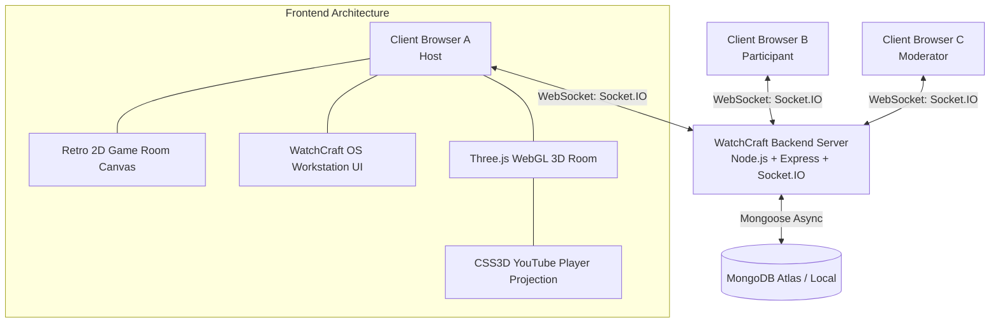
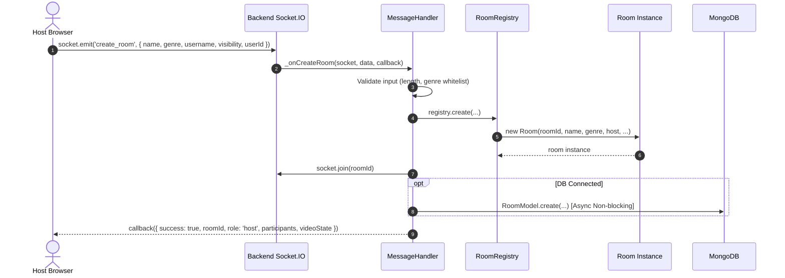
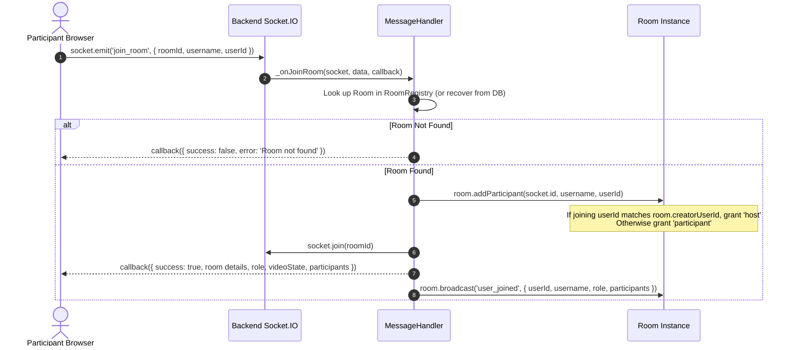
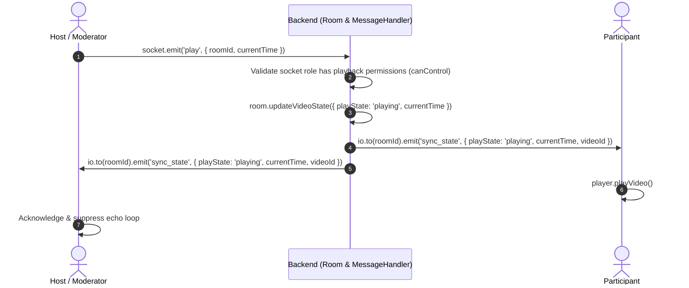
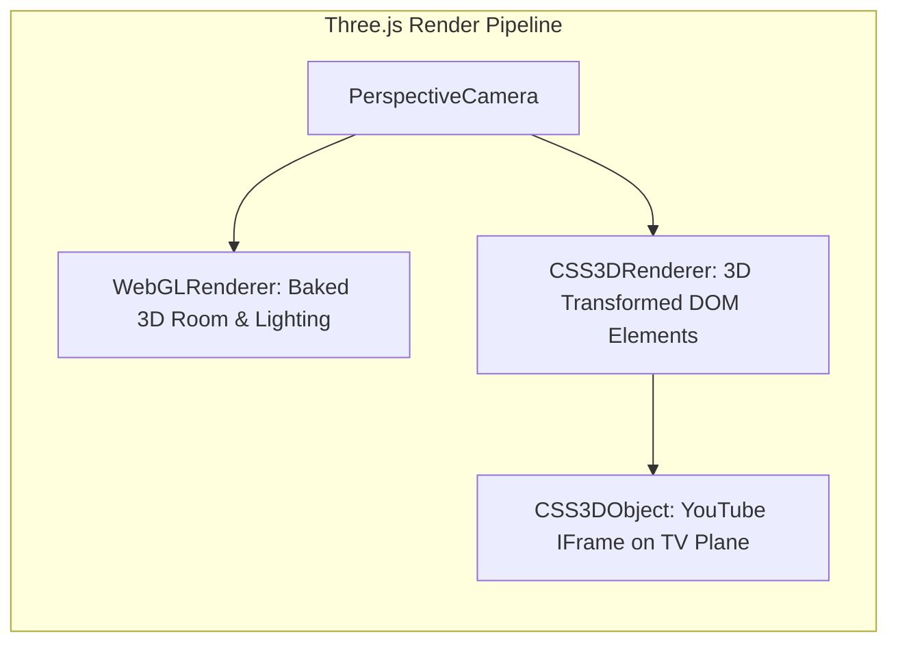
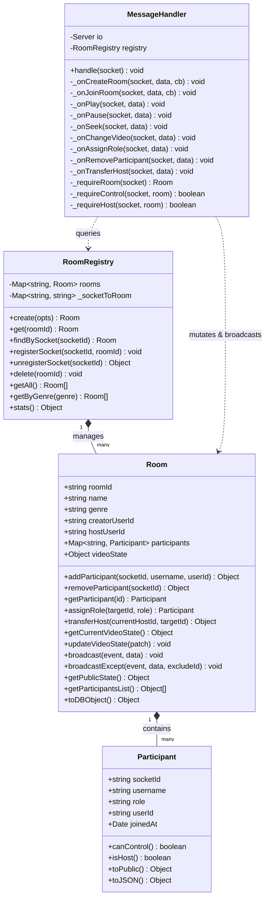
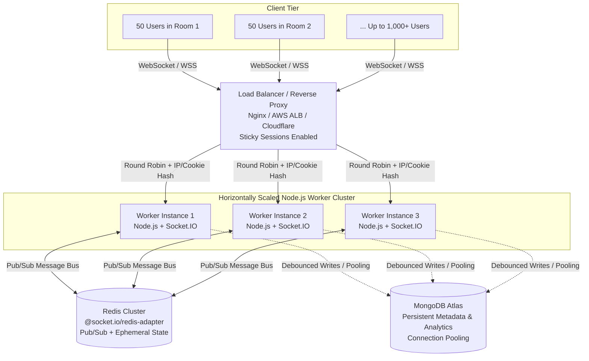

# WatchCraft — Technical Architecture Documentation

This document describes the architectural design, data models, communication protocols, synchronization mechanisms, and component interactions in **WatchCraft**.

---

## 1. System Overview

WatchCraft is a real-time, synchronized YouTube watch party application designed around two interactive environments:
1. **A Retro 2D Isometric Apartment (`GameRoomScreen.jsx`)**: An interactive 2D pixel world where users explore, interact with items, view official documents, and boot up the WatchCraft workstation computer.
2. **An Immersive 3D First-Person Room (`WatchRoom3D.jsx`)**: A Three.js 3D baked room where the synchronized YouTube video is rendered directly onto a 3D television using CSS3D transform matrices aligned with the WebGL camera, complete with first-person mouse-look and real-time multiplayer chat/participant overlays.

The backend is built as a stateful, event-driven Node.js service using Object-Oriented Programming (OOP) principles and Socket.IO, with non-blocking MongoDB persistence.



---

## 2. Component Hierarchy & Data Flow

### 2.1 Frontend Architecture (`src/`)

- **`App.jsx`**: Top-level state coordinator. Controls the scene transitions:
  - `preloader`: Asset preloading bar tracking textures, models, and audio.
  - `start_prompt`: Intro banner with floating animation & start button.
  - `2d_room`: Isometric 2D pixel apartment (`GameRoomScreen.jsx`).
  - `computer_boot`: CRT terminal boot sequence into WatchCraft OS.
  - `computer_login`: Username input & local identity setup.
  - `computer_desktop`: Windowed workstation (`WatchlyDesktop.jsx`) to create/join rooms or browse public rooms.
  - `3d_room`: The 3D theater room (`WatchRoom3D.jsx`).
- **`WatchRoom3D.jsx`**: The core theater component.
  - Integrates **Three.js** (`WebGLRenderer` for geometry, lighting, materials, and baked day/night textures) and **CSS3DRenderer** (for embedding the YouTube iframe directly on the TV mesh).
  - Handles **First-Person PointerLock / Mouse-Look controls** allowing users to look around the room.
  - Overlays chat, reactions, participant list, role badges, video search bar, volume slider, and fullscreen controls.
- **`socket.js`**: Centralized Socket.IO client instance using singleton connection patterns with auto-reconnection and event dispatching.
- **`sounds.js`**: Web Audio API sound synthesizer and background audio manager for retro sound effects without external audio file loading overhead.

### 2.2 Backend Architecture (`watchly-backend/src/`)

The backend follows clean **Object-Oriented Programming (OOP)** structure:

```
watchly-backend/src/
├── classes/
│   ├── Participant.js      # Encapsulates a connected user, role, and permission methods
│   ├── Room.js             # Encapsulates a watch room, authoritative playback state, participant list
│   ├── RoomRegistry.js     # Manages in-memory active rooms, O(1) socket indexing, statistics
│   └── MessageHandler.js   # Encapsulates WebSocket event routing, payload validation, RBAC checks
├── db/
│   └── mongodb.js          # Graceful MongoDB connection with offline fallback
├── models/
│   └── Room.model.js       # Mongoose schema for persistent room metadata & analytics
├── routes/
│   └── rooms.js            # REST API endpoints for room listing, validation, and stats
└── index.js                # Express & HTTP server entry point, Socket.IO binding
```

---

## 3. Room Lifecycle & Membership

### 3.1 Room Creation Flow



1. The client requests room creation via `create_room` over WebSocket.
2. The server generates a unique **6-character alphanumeric room code** (e.g., `WK92LM`).
3. The creator is registered as `Participant` with role `'host'` tied to their persistent `userId`.
4. The socket joins the Socket.IO room channel `io.to(roomId)`.
5. Room metadata is saved asynchronously to MongoDB. If MongoDB is unavailable, the room continues operating fully in-memory without disruption.

### 3.2 Room Joining Flow



Late joiners immediately receive the authoritative `videoState` (`videoId`, `playState`, `currentTime`) in the join callback or via `sync_state`, allowing their YouTube player to synchronize accurately on initial load.

---

## 4. Playback Synchronization Protocol

WatchCraft enforces a **server-authoritative** playback model. Individual clients do not broadcast commands directly to each other; all mutations pass through the server for validation and state storage before being broadcast.

### 4.1 Sync Event Cycle



### 4.2 Loop Prevention & Drift Mitigation
1. **Echo Prevention**: When a client triggers `play` or `seek`, it marks an internal flag (`isRemoteUpdate.current = true`). When the broadcasted `sync_state` returns to the sender, the client ignores redundant API calls, preventing infinite broadcast cascades.
2. **Drift Threshold**: During continuous playback, clients calculate the delta between local player time and the broadcasted authoritative timestamp:
   $$\Delta t = |t_{\text{local}} - t_{\text{authoritative}}|$$
   If $\Delta t < 2.0\text{ seconds}$, the client lets playback proceed naturally without disrupting audio/video buffer. If $\Delta t \ge 2.0\text{ seconds}$, an explicit `player.seekTo(t)` is triggered.
3. **Seek Rate Limiting**: Seek events are throttled on the client and validated on the backend to avoid hammering the YouTube IFrame API or flooding WebSocket bandwidth.

---

## 5. Role-Based Access Control (RBAC)

The server enforces roles strictly in `Participant.js` and `MessageHandler.js`:

| Role | Play / Pause | Seek | Change Video | Promote / Demote | Kick Participant | Transfer Host |
| :--- | :---: | :---: | :---: | :---: | :---: | :---: |
| **Host** | Yes | Yes | Yes | Yes | Yes | Yes |
| **Moderator** | Yes | Yes | Yes | No | No | No |
| **Participant** | No* | No* | No* | No | No | No |

*\*Participants can use the "Request Control" feature (`request_control`), which sends a notification to the Host allowing them to promote the participant to Moderator.*

### 5.1 Server-Side Validation
Hiding buttons on the client is strictly for UX. Every mutating WebSocket event executes:
```javascript
const participant = room.getParticipant(socket.id);
if (!participant || !participant.canControl()) {
  return socket.emit('error', { message: 'Unauthorized: Moderator or Host role required' });
}
```
If an unauthorized socket emits `play`, `pause`, `seek`, or `change_video`, the server drops the message and returns an authorization error.

### 5.2 Host Disconnection & Auto-Transfer
If the Host disconnects:
1. The server flags the host as departed.
2. If other participants remain, the server automatically promotes the oldest connected participant to **Host** (`room.promoteNextHost()`).
3. A `role_assigned` event is broadcast to all participants to update badges and capabilities immediately.
4. If the original host reconnects with their persistent `userId`, host ownership is seamlessly restored.

---

## 6. YouTube IFrame & 3D CSS3D TV Integration

WatchCraft renders the YouTube IFrame in a true 3D spatial coordinate system rather than a flat canvas overlay:



### 6.1 Spatial Alignment
1. In `WatchRoom3D.jsx`, a `CSS3DRenderer` is overlaid on top of the Three.js `WebGLRenderer` canvas with matching dimensions and projection matrix.
2. A hidden TV screen plane mesh is located in the 3D room model at coordinate:
   $$\text{position} = (0.23, 1.34, -1.82), \quad \text{rotation} = (0, 0, 0)$$
3. The YouTube `<iframe>` is wrapped in a `CSS3DObject` matching the TV's exact world dimensions and aspect ratio (16:9).
4. As the user moves the mouse, the Three.js camera rotates, and both WebGL geometry and the CSS3D YouTube plane transform synchronously in hardware-accelerated 3D space.

### 6.2 Local vs. Shared Preferences
- **Shared State**: Video ID, playback status (`playing`, `paused`), and timestamp are synchronized across all connected users.
- **Local State**: Audio volume, mute status, camera orientation, mouse sensitivity, and fullscreen toggle are kept strictly local to each user's browser session.

---

## 7. Security Architecture

1. **Input Sanitization**:
   - Room names are limited to 80 characters.
   - Usernames are trimmed and sanitized against XSS.
   - Chat messages are capped at 500 characters and sanitized before broadcast.
   - YouTube URLs and video IDs are extracted and validated against standard YouTube ID regex `^[a-zA-Z0-9_-]{11}$`.
2. **Room Isolation**: All broadcasts use Socket.IO room namespaces `io.to(roomId).emit(...)`. Sockets cannot listen or broadcast to rooms they have not joined.
3. **Environment Security**: No secrets or credentials are hardcoded. Database connection strings, ports, and allowed CORS origins are injected via environment variables.
4. **CORS Configuration**: Socket.IO and Express CORS restrict cross-origin requests to configured client domains (`CLIENT_URL`).

---

## 8. Object-Oriented (OOP) Design & Domain Encapsulation

WatchCraft's backend explicitly implements the assignment's **OOP concepts for WebSocket servers** bonus requirement through four cohesive classes:



### 8.1 Encapsulation Breakdown

1. **`Participant` Class (`Participant.js`)**:
   - **Responsibility**: Encapsulates a connected user's identity, role, and capabilities.
   - **Encapsulated Queries**: Replaces raw string checks across the codebase with domain methods: `canControl()` returns `role === 'host' || role === 'moderator'`; `isHost()` returns `role === 'host'`.
   - **Information Hiding**: `toPublic()` strips internal server metadata before serializing participant data for client broadcast.

2. **`Room` Class (`Room.js`)**:
   - **Responsibility**: Encapsulates room state, authoritative playback time, participant collections, and room-scoped networking.
   - **Dynamic Playback Extrapolation**: `getCurrentVideoState()` automatically calculates elapsed playback time dynamically using `(Date.now() - videoState.updatedAt) / 1000`, preventing discrete timestamp staleness without running wasteful interval timers on the server.
   - **Lifecycle & Identity Protection**: `addParticipant()` detects whether a re-connecting user was the room's original creator via persistent `creatorUserId`, restoring their Host privileges and gracefully demoting temporary hosts.
   - **Automatic Host Migration**: `removeParticipant()` prioritizes promoting active Moderators to Host when the primary host departs, falling back to remaining Participants, ensuring zero room downtime.

3. **`RoomRegistry` Class (`RoomRegistry.js`)**:
   - **Responsibility**: Manages in-memory room lifecycle and rapid lookup.
   - **$O(1)$ Reverse Indexing**: Maintains an internal `_socketToRoom` Map alongside `rooms` Map. Socket lookups on disconnection or event emission operate in $O(1)$ constant time without iterating through room collections.
   - **Idle Grace Period**: Implements a 15-minute scheduled cleanup delay for empty rooms (`scheduleCleanup()`), allowing accidental page refreshes without destroying room state.

4. **`MessageHandler` Class (`MessageHandler.js`)**:
   - **Responsibility**: Decouples transport protocol (Socket.IO events) from domain business logic.
   - **Role Enforcement Guards**: Encapsulates guard validation (`_requireRoom`, `_requireControl`, `_requireHost`) and standardizes error responses.
   - **Input Sanitization**: Encapsulates YouTube URL parsing via regex (`_extractYouTubeId`), message length limits (500 chars), and emoji whitelist verification.

---

## 9. Scalability Analysis & High-Concurrency Roadmap

### 9.1 Evaluation Against Assignment Targets

The assignment specification defines the following high-concurrency benchmark:
- **1,000+ Concurrent Users**
- **100+ Active Rooms**
- **50+ Participants per Room**



### 9.2 Current Single-Node Architectural Limits

1. **Memory Capacity**:
   - Raw data structures for 100 rooms $\times$ 50 users = 5,000 active participants.
   - Each `Participant` instance: $\approx 200\text{ bytes}$.
   - Each `Room` instance: $\approx 2\text{ KB} + (50 \times 200\text{ bytes}) \approx 12\text{ KB}$.
   - Total room heap consumption: $100 \times 12\text{ KB} \approx 1.2\text{ MB}$.
   - Even factoring Socket.IO connection buffers ($\approx 15\text{ KB}$ per TCP socket), 1,000 active sockets consume $\approx 25\text{ MB}$ of RAM, well below Node's 1.4 GB default V8 heap.
2. **CPU & Event Loop Bottlenecks**:
   - While memory is sufficient, Node.js executes JavaScript on a single thread.
   - For a room with 50 participants, a single `chat_message` or `reaction` burst requires the server to serialize and dispatch 50 WebSocket frames.
   - Under 100 concurrent rooms experiencing frequent chat, reactions, and seeks, JSON serialization and TCP socket flushing will degrade event loop latency ($>100\text{ms}$ lag), leading to sync drift.
3. **Single Point of Failure (SPOF)**:
   - A single process crash, memory leak, or container restart terminates all 100 rooms simultaneously.

### 9.3 Horizontal Scaling Architecture with Redis

To scale horizontally across multiple container instances (e.g., 3–5 Node.js replicas), the following components are required:

#### A. Cross-Instance Broadcasting via Redis Adapter
When Server 1 and Server 2 host participants belonging to the same Room `AB12XY`:
- Without an adapter, Server 1's `io.to('AB12XY').emit('sync_state')` only reaches sockets connected to Server 1.
- By integrating `@socket.io/redis-adapter` with a Redis Pub/Sub instance, emits are published to a Redis channel (`socket.io#AB12XY#`). All worker instances subscribe to active rooms and re-broadcast packets to their local sockets.

#### B. Ephemeral Room State in Redis
- Centralize authoritative playback state in Redis Hashes (`watchcraft:room:<roomId>:state`) using atomic commands:
  - `HSET watchcraft:room:AB12XY videoId "aqz-KE-bpKQ" playState "playing" currentTime 14.5 updatedAt 1728580000000`
- Any worker instance can validate permissions and retrieve the exact playback time via Redis in under $1\text{ms}$.

#### C. Load Balancer with Session Affinity (Sticky Sessions)
- Socket.IO initiates connections via HTTP long-polling handshakes before upgrading to WebSocket.
- The load balancer (AWS ALB, Nginx, or Traefik) must enforce **Cookie-based sticky sessions** (or hash on IP address) so that handshake requests hit the same worker until upgraded.
- Alternatively, enforce pure WebSocket transport on the client (`transports: ['websocket']`) to bypass HTTP polling handshakes entirely.

#### D. Database Write Debouncing & Connection Pooling
- Currently, participant join/leave events update MongoDB immediately via `findOneAndUpdate`.
- Under 1,000+ users, direct database writes would exceed connection limits on free tiers (MongoDB Atlas M0 limit: 100 connections).
- **Optimization Strategy**:
  - Configure Mongoose connection pooling: `maxPoolSize: 50`, `minPoolSize: 10`.
  - Debounce viewer count and video state persistence: accumulate counters in memory / Redis and batch-sync to MongoDB every 15–30 seconds.
